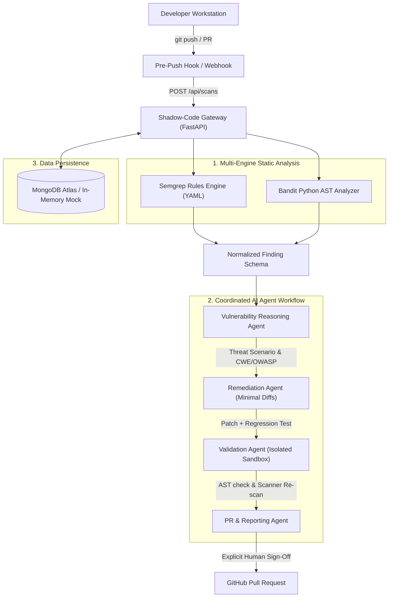

# 🛡️ Shadow-Code: Agentic AI-Powered Secure SDLC Auditor

[](https://github.com/Sachinshekhar82/Shadow-code/actions)
[](LICENSE)
[](https://www.python.org/)
[](https://fastapi.tiangolo.com/)
[](https://react.dev/)
[](https://semgrep.dev/)

> **Shadow-Code** is an enterprise-grade DevSecOps platform and pre-push / PR interception gate that combines deterministic static security analysis (Semgrep & Bandit) with contextual LLM reasoning, isolated sandbox patch validation, and GitHub Pull Request gating.

---

## 1. System Architecture



---

## 2. Core Modules & Agent Responsibilities

### Multi-Engine Static Analysis
- **Semgrep Rules Engine**: Multi-language pattern matching for Command Injection (CWE-78), SQL Injection (CWE-89), Insecure Deserialization (CWE-502), and Weak Cryptography (CWE-328).
- **Bandit AST Analyzer**: Deep Python abstract syntax tree analyzer flagging insecure imports, subprocess misuse, and hardcoded secrets.
- **Normalization Layer**: Combines findings from both engines into a unified schema, removes duplicates, attaches source code context (±3 lines), and normalizes severity ratings.

### Coordinated Agent Workflows
1. **Repository Analysis Agent**: Maps directory structure, entry points, route handlers, and sensitive data flows.
2. **Vulnerability Reasoning Agent**: Analyzes code context to verify exploitability, constructs realistic threat models and attack scenarios, maps to CWE / OWASP Top 10, and filters false positives.
3. **Remediation Agent**: Synthesizes surgical, minimal unified diffs and generates automated regression tests.
4. **Validation Agent**: Operates in an isolated temporary sandbox, checks Python syntax with `ast.parse`, re-runs Semgrep and Bandit on patched code to confirm vulnerability resolution, and validates regression test assertions.
5. **PR & Reporting Agent**: Formats audit reports and publishes Pull Requests with dedicated remediation branches to GitHub upon explicit human approval.

---

## 3. Technology Stack

- **Backend**: Python 3.11+, FastAPI, Uvicorn, Pydantic v2, PyMongo, mongomock, PyGithub, Bandit, Semgrep, Pytest.
- **Frontend**: React 19, Vite, TypeScript, Tailwind CSS, Lucide React, Recharts.
- **Database**: MongoDB Atlas / Local MongoDB, with automatic graceful fallback to mongomock when offline.
- **CI/CD**: GitHub Actions workflow (`.github/workflows/security-sdlc.yml`).

---

## 4. Getting Started

### Prerequisites
- Python 3.11+
- Node.js 18+ & npm
- Git

### Quick Setup

1. **Clone the Repository**:
   ```bash
   git clone https://github.com/Sachinshekhar82/Shadow-code.git
   cd Shadow-code
   ```

2. **Backend Setup**:
   ```bash
   # Create and activate virtual environment
   python -m venv .venv
   # Windows:
   .\.venv\Scripts\Activate.ps1
   # Linux/macOS:
   source .venv/bin/activate

   # Install dependencies
   pip install -r backend/requirements.txt
   ```

3. **Frontend Setup**:
   ```bash
   cd frontend
   npm install
   cd ..
   ```

4. **Environment Configuration**:
   ```bash
   cp .env.example .env
   ```
   Edit `.env` to configure your `MONGODB_URI` and optional `GITHUB_TOKEN` for remote repository Pull Requests.

---

## 5. Running the Application

### Option A: Using Helper Scripts (Windows)
```powershell
# In Terminal 1 (Backend):
.\scripts\start_backend.ps1

# In Terminal 2 (Frontend):
.\scripts\start_frontend.ps1
```

### Option B: Manual Execution
```bash
# Terminal 1: Backend
uvicorn backend.app.main:app --host 127.0.0.1 --port 8000 --reload

# Terminal 2: Frontend
cd frontend
npm run dev
```

- **Frontend Dashboard**: [http://127.0.0.1:5173](http://127.0.0.1:5173)
- **FastAPI Interactive Docs**: [http://127.0.0.1:8000/docs](http://127.0.0.1:8000/docs)
- **API Health Check**: [http://127.0.0.1:8000/api/health](http://127.0.0.1:8000/api/health)

---

## 6. Installing the Git Pre-Push Gate

To prevent insecure code from reaching the remote repository `https://github.com/Sachinshekhar82/Shadow-code.git`:

```bash
# Install the hook
cp scripts/pre-push .git/hooks/pre-push
chmod +x .git/hooks/pre-push
```

Every time you execute `git push`, the hook scans staged code via the Shadow-Code engine and aborts the push if unmitigated Critical or High severity vulnerabilities are detected.

---

## 7. Running Tests & Research Evaluation

### Automated Pytest Suite
```bash
# Run the complete test suite (API, Database, Reports, Scanners & Agents)
pytest -v
```

---

## 8. MongoDB Atlas Database & Persistent Collections

Shadow-Code uses MongoDB Atlas for enterprise-grade persistent audit logging and vulnerability lifecycle management.

### Environment Variables
Configure your MongoDB Atlas cluster in `backend/.env`:

```env
MONGODB_URI=mongodb+srv://<db_username>:<db_password>@cluster0.asesgi4.mongodb.net/?retryWrites=true&w=majority&appName=Cluster0
MONGODB_DATABASE=shadow_code
```

### Persistent Collections & Automated Indexes
The centralized `MongoDBManager` verifies connectivity via an admin ping command upon startup and ensures the following query indexes:

1. **`repositories`**:
   - `id` (Unique index)
   - `url` (Ascending)
   - `created_at` (Descending)
2. **`scans`**:
   - `id` (Unique index)
   - `repository_id` + `commit_sha` (Compound index)
   - `created_at` (Descending)
   - `status` (Ascending)
3. **`findings`**:
   - `id` (Unique index)
   - `scan_id`, `repository_id`, `severity`, `remediation_status`
   - `created_at` (Descending)
4. **`remediations`**:
   - `id` (Unique index)
   - `finding_id`, `scan_id`, `approval_status`, `validation_status`
   - `created_at` (Descending)
5. **`agent_runs`**:
   - `id` (Unique index)
   - `scan_id`, `finding_id`, `started_at`
6. **`pull_requests`**:
   - `id` (Unique index)
   - `repository_id`, `scan_id`, `remediation_id`, `status`

---

## 9. Report Generation & Download Engine

Shadow-Code generates compliance and security reports in three formats:

| Format | MIME Type | Filename | Key Capabilities |
| :--- | :--- | :--- | :--- |
| **PDF** | `application/pdf` | `shadow-code-audit-<id>.pdf` | Enterprise executive summary, CVSS severity distribution, code evidence blocks, AI remediation details, page numbers ("Page X of Y"), and audit scope limitations. Generated via ReportLab. |
| **CSV** | `text/csv; charset=utf-8` | `shadow-code-audit-<id>.csv` | RFC 4180 compliant tabular export with spreadsheet formula injection defense (prepends `'` to cells starting with `=`, `+`, `-`, `@`, `\t`, `\r`). |
| **JSON** | `application/json` | `shadow-code-audit-<id>.json` | Complete machine-readable audit report payload including enriched findings, scanner metrics, and pull request metadata. |

---

## 10. REST API Reference

| Method | Endpoint | Description |
|---|---|---|
| `GET` | `/api/health` | Service health status, MongoDB ping latency, and scanner availability |
| `GET` | `/api/dashboard` | Dashboard metrics, severity breakdown, and health score |
| `GET` | `/api/repositories` | List monitored repositories with pagination (`limit`, `skip`) |
| `POST` | `/api/repositories` | Register a new repository for auditing |
| `POST` | `/api/scans` | Launch an authorized static security audit scan |
| `GET` | `/api/scans` | Retrieve scan execution history with pagination |
| `GET` | `/api/scans/{scan_id}` | Retrieve specific scan details |
| `GET` | `/api/scans/{scan_id}/findings` | Retrieve all normalized findings for a scan |
| `GET` | `/api/findings` | Filterable findings list (`severity`, `repository_id`, `status`) |
| `GET` | `/api/findings/{id}` | Inspect individual vulnerability finding |
| `POST` | `/api/findings/{id}/analyze` | Trigger contextual AI threat reasoning |
| `POST` | `/api/findings/{id}/remediate` | Propose minimal diff patch & regression test |
| `POST` | `/api/remediations/{id}/validate` | Run sandbox AST syntax and re-scan validation |
| `POST` | `/api/remediations/{id}/create-pr` | Stage dedicated branch and open GitHub PR |
| `GET` | `/api/pull-requests` | List staged and active Pull Requests |
| `POST` | `/api/chat` | Query the grounded security chatbot |
| `GET` | `/api/analytics/trends` | Vulnerability trend metrics over time |
| `GET` | `/api/reports/{scan_id}` | JSON preview of audit report |
| `GET` | `/api/reports/{scan_id}/download` | Download report file (`format=pdf`, `csv`, or `json`) |
| `POST` | `/api/webhook/github` | GitHub webhook handler with HMAC-SHA256 verification |

---

## 11. Production Deployment Guide

Shadow-Code is designed for zero-friction containerized or cloud deployment.

### Option A: Docker (Recommended for Single-Host or VPS)
Build and run the entire unified full-stack application (React UI + FastAPI + Scanners):

```bash
# 1. Build unified production image
docker build -t shadow-code .

# 2. Run container (with your .env file)
docker run -d -p 8000:8000 --env-file backend/.env --name shadow-code shadow-code
```
Access the application at `http://localhost:8000`.

### Option B: Docker Compose (App + Local MongoDB)
Run the application with an isolated, persistent local MongoDB database:

```bash
docker compose up -d --build
```

### Option C: Cloud PaaS Deployment (Render / Railway / Fly.io)
The repository includes a ready-to-use `render.yaml` blueprint and `Procfile`.
1. Fork or push this repository to GitHub.
2. In **Render** (or **Railway**), create a new **Web Service** connected to your repository.
3. Set Environment to `Python 3`.
4. Build command:
   ```bash
   pip install -r backend/requirements.txt && cd frontend && npm install && npm run build && cd ..
   ```
5. Start command:
   ```bash
   uvicorn backend.app.main:app --host 0.0.0.0 --port $PORT
   ```
6. Add your environment secrets (`GEMINI_API_KEY`, `MONGODB_URI`, `GITHUB_TOKEN`).

### Option D: Split Deployment (Vercel Frontend + Cloud Backend)
- **Frontend (Vercel)**: Connect repository to Vercel (uses included `vercel.json`). Set `VITE_API_URL` to your deployed backend URL.
- **Backend (Render / Railway)**: Deploy backend and set `CORS_ORIGINS` to your Vercel domain.

---

## 12. Security Policies & Guardrails

1. **Human-in-the-Loop Sign-off**: No patch is ever merged automatically. Every proposed fix requires developer or security engineer approval.
2. **Untrusted Code Isolation**: Patches are executed in isolated temporary scratch directories with resource limits and timeouts.
3. **Secret Redaction**: Credentials, tokens, and API keys are automatically scrubbed from logs and reports using regex pattern matching.
4. **Prompt Injection Defense**: Code comments containing instruction-override triggers are flagged and neutralized before LLM processing.
5. **HMAC Webhook Signatures**: All incoming GitHub webhooks are verified against `X-Hub-Signature-256`.

---

## 13. License
This project is licensed under the MIT License.
